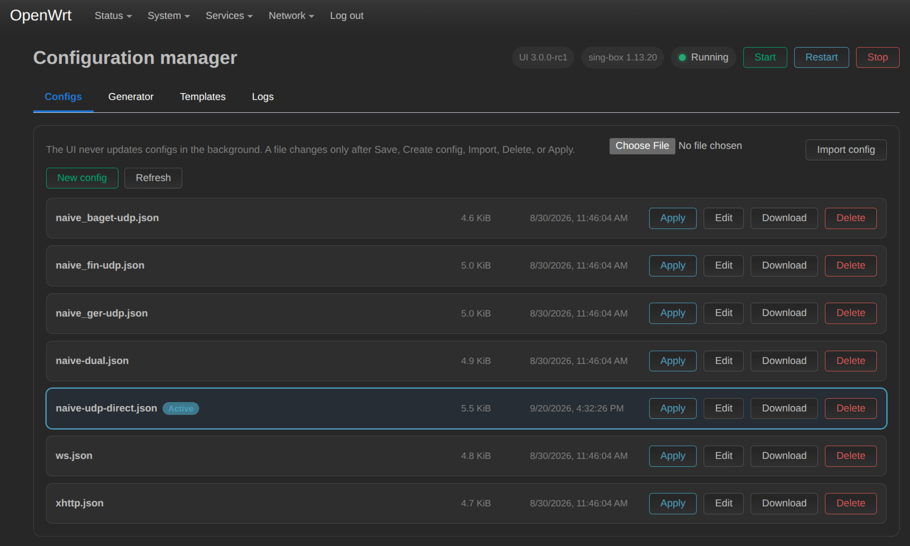

# luci-app-singbox-ui

[Русский](./README.ru.md)

Web interface for managing Sing-Box on OpenWrt 23/24/25.

## Disclaimer
> This project is intended strictly for educational and research purposes.
> The author takes no responsibility for misuse, device damage, or any consequences.
> Use at your own risk.

## Screenshot


## Features
- Start, stop, and restart Sing-Box
- Discover every JSON config in /etc/sing-box/
- Apply, edit, import, download, or delete configs from a compact list
- Format JSON and highlight its syntax without a heavyweight editor dependency
- Generate configs from VLESS, VMess, Trojan, Shadowsocks, Hysteria(2), TUIC, SOCKS and HTTP links
- Create and switch between multiple editable routing/DNS templates
- Never overwrite configs in the background
- Check service state and validate configs with the separately installed sing-box binary
- Detect IPK/APK and OpenWrt architecture for Original, Extended, or Clean core builds

## Installation
```bash
wget -O /root/install.sh https://raw.githubusercontent.com/mrvokintos/luci-app-singbox-ui/main/install.sh && chmod 0755 /root/install.sh && BRANCH="main" sh /root/install.sh
```

The script adds the [openwrt.mrvokintos.ru](https://openwrt.mrvokintos.ru) repository, installs the panel from it and starts `singbox-ui`, a full-screen setup screen:

| Setting | Values |
| --- | --- |
| sing-box core | `Original`, `Extended`, `Clean`, `Clean Extended`. On `aarch64_cortex-a53` the Clean builds come from the repository, elsewhere from GitHub |
| Update channel | `stable` (releases only), `beta` (pre-releases), `git` (builds of `main`), `dev` (builds of `dev`). Until the first stable release `install.sh` uses `beta` |
| Auto-update | off, panel only, panel and core. Default: panel only for stable and beta, off for git and dev (enable it by hand) |
| IPv6 | disable or keep |
| config.json | keep or open in an editor |

`Apply` shows the planned changes first. The same screen also installs a panel build from CI artifacts (PR / commit) and removes everything.

`singbox-ui` ships with the package, so it can be run again at any time. Without a terminal, or with `--plain`, it asks the questions one by one; `--yes` applies without questions, `--dry-run` only prints the commands. Use `↑`/`↓` (or `j`/`k`), `Enter`, and `q` or `←` to go back.

Choose the channel with `CHANNEL=dev sh /root/install.sh`.

### Auto-update
Auto-update is a nightly cron job (`/usr/libexec/singbox-ui-autoupdate`). The core is updated only if it was installed from the repository, and only if the new binary accepts the current `config.json`; otherwise it is left alone and the reason goes to the system log (`logread -e singbox-ui`).

### Installing from the repository manually
```bash
wget -O /etc/apk/keys/openwrt.rsa.pub https://openwrt.mrvokintos.ru/keys/openwrt.rsa.pub
echo "https://openwrt.mrvokintos.ru/packages/all/APKINDEX.tar.gz" > /etc/apk/repositories.d/mrvoki.list
apk update && apk add luci-app-singbox-ui
singbox-ui
```
apk 3 needs the full path to `APKINDEX.tar.gz`. Without it, it looks for the index in `<url>/<arch>/`. The panel also shows a reminder until the initial setup is done.

## Quick Tips
Clear old SSH key:
```bash
ssh-keygen -R 192.168.1.1
```

Connect to router:
```bash
ssh root@192.168.1.1
```

If LuCI page is not visible after install, do a hard refresh.

## Config Templates
- [openwrt-template](https://raw.githubusercontent.com/mrvokintos/luci-app-singbox-ui/main/other/file/openwrt-template.json)
- [Sing-Box Configuration](https://sing-box.sagernet.org/configuration/)

## Contributing
Issues and pull requests are welcome.

## License
GNU General Public License v2.0 (GPL-2.0-only). See [LICENSE](./LICENSE).

## Stargazers over time
[](https://starchart.cc/mrvokintos/luci-app-singbox-ui)
