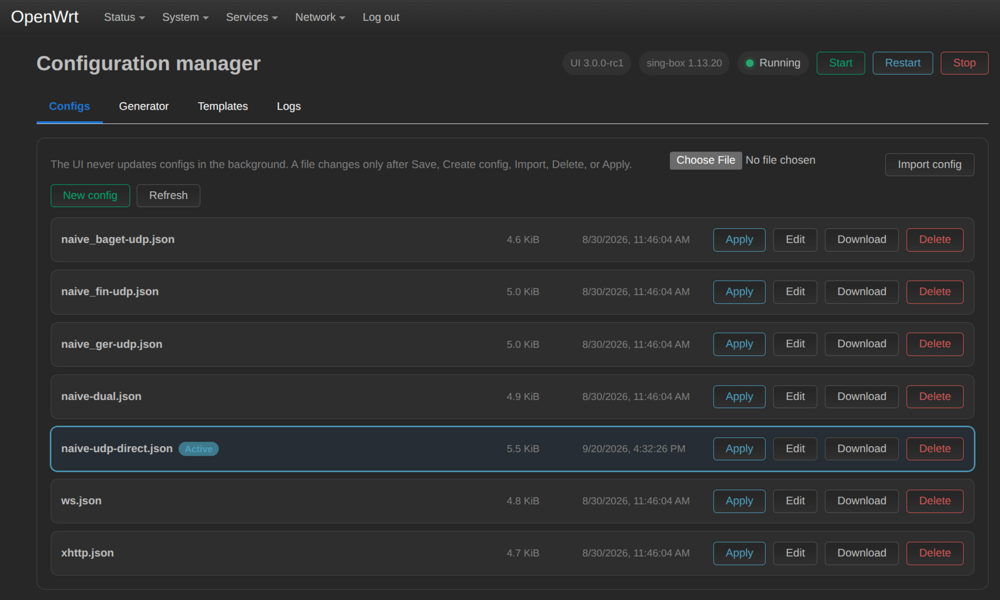

# luci-app-singbox-ui

[English](./README.md)

Веб-интерфейс для управления Sing-Box на OpenWrt 23/24/25.

## Предупреждение
> Проект предназначен только для образовательных и исследовательских целей.
> Автор не несет ответственности за неправильное использование, поломку устройств и любые последствия.
> Использование на ваш страх и риск.

## Скриншот


## Возможности
- Запуск, остановка и перезапуск Sing-Box
- Автоматический поиск всех JSON-файлов в /etc/sing-box/
- Применение и редактирование конфигов из компактного списка
- Генерация конфигов из ссылок VLESS, VMess, Trojan, Shadowsocks, Hysteria(2), TUIC, SOCKS и HTTP
- Редактируемый шаблон с DNS, маршрутами и дополнительными outbound
- Никакой фоновой перезаписи конфигов
- Проверка состояния сервиса и конфигов через отдельно установленный бинарник sing-box
- Автоматический выбор IPK/APK и архитектуры для Original, Extended или Clean ядра

## Установка
```bash
wget -O /root/install.sh https://raw.githubusercontent.com/mrvokintos/luci-app-singbox-ui/main/install.sh && chmod 0755 /root/install.sh && BRANCH="main" sh /root/install.sh
```

Скрипт подключает репозиторий [openwrt.mrvokintos.ru](https://openwrt.mrvokintos.ru), ставит из него панель и запускает `singbox-ui` — полноэкранную настройку:

| Настройка | Значения |
| --- | --- |
| Ядро sing-box | `Original`, `Extended`, `Clean`, `Clean Extended`. На `aarch64_cortex-a53` сборки Clean ставятся из репозитория, на других архитектурах — с GitHub |
| Канал обновлений | `stable`, `beta`, `git` (сборки `main`), `dev` (сборки `dev`) |
| Автообновление | выключено, только панель, панель и ядро. По умолчанию: только панель для stable и beta, выключено для git и dev (включается вручную) |
| IPv6 | отключить или не менять |
| config.json | не менять или открыть в редакторе |

Перед применением «Применить» показывает, что будет сделано. Там же можно поставить сборку панели из артефактов CI (PR / коммит) и удалить всё.

`singbox-ui` входит в пакет, его можно запускать повторно в любой момент. Без терминала или с `--plain` он задаёт вопросы по очереди; `--yes` применяет без вопросов, `--dry-run` только показывает команды. Управление: `↑`/`↓` (или `j`/`k`), `Enter`, `q` или `←` — назад.

Канал выбирается так: `CHANNEL=dev sh /root/install.sh`.

### Автообновление
Автообновление — ночная задача cron (`/usr/libexec/singbox-ui-autoupdate`). Ядро обновляется, только если оно поставлено из репозитория и новый бинарник принимает текущий `config.json`. Иначе ядро не трогается, причина пишется в системный лог (`logread -e singbox-ui`).

### Установка из репозитория вручную
```bash
wget -O /etc/apk/keys/openwrt.rsa.pub https://openwrt.mrvokintos.ru/keys/openwrt.rsa.pub
echo "https://openwrt.mrvokintos.ru/packages/all/APKINDEX.tar.gz" > /etc/apk/repositories.d/mrvoki.list
apk update && apk add luci-app-singbox-ui
singbox-ui
```
apk 3 нужен полный путь к `APKINDEX.tar.gz`, без него он ищет индекс в `<url>/<arch>/`. Пока первоначальная настройка не сделана, панель показывает напоминание.

## Быстрые подсказки
Очистить старый SSH-ключ:
```bash
ssh-keygen -R 192.168.1.1
```

Подключиться к роутеру:
```bash
ssh root@192.168.1.1
```

Если страница LuCI не появилась после установки, выполните жесткое обновление страницы в браузере.

## Шаблоны конфигурации
- [openwrt-template](https://raw.githubusercontent.com/mrvokintos/luci-app-singbox-ui/main/other/file/openwrt-template.json)
- [Sing-Box Configuration](https://sing-box.sagernet.org/configuration/)

## Вклад
Issues и pull request приветствуются.

## Лицензия
GNU General Public License v2.0 (GPL-2.0-only). См. [LICENSE](./LICENSE).

## Stargazers over time
[](https://starchart.cc/mrvokintos/luci-app-singbox-ui)
